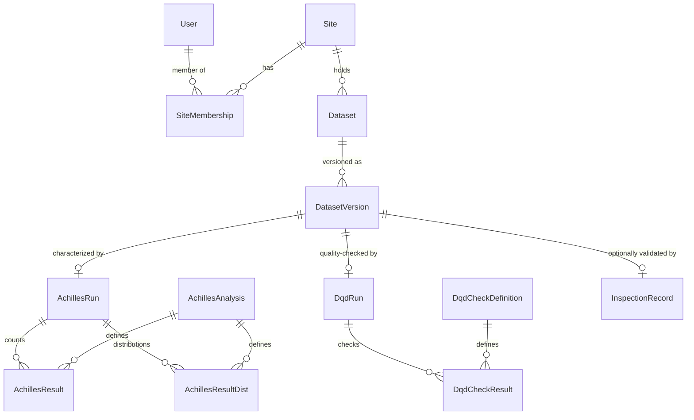

# "Dataset" side — proposed data model (design only)

> Status: **proposal for discussion — nothing implemented.** No Prisma models or
> migrations. Grounded in EHDEN's data‑partner catalogue + onboarding, the OMOP
> `CDM_SOURCE` table, and the actual output schemas of **Achilles** (database
> characterization) and the **Data Quality Dashboard (DQD)**.
>
> This is the concrete realization of **Layer D `DataSource`** from
> [study-data-model.md](./study-data-model.md): a data cut here is what a
> `StudyRun` executes against.
>
> **Naming update (2026-08-14):** the OMOP data-cut model described below as
> `DatasetVersion` was **renamed to `DatasetRelease`** in code, to free the
> "version" name for uniform editing/versioning. A `Dataset` now has two axes:
> **`DatasetRelease`** (the OMOP data cuts described here) and **`DatasetVersion`**
> (immutable snapshots of the dataset's *catalog metadata*, mirroring
> `StudyVersion`/`SiteVersion`). Read "DatasetVersion" below as "DatasetRelease".

## 1. Core shape

```
Site (data partner)          ← a site owner enrolls this
  └─ Dataset (an OMOP database)          ← visibility set here
       └─ DatasetVersion (a CDM_SOURCE data cut)   ← versioning happens here
            ├─ [tier 1] descriptive metadata        (always)
            ├─ [tier 2] Achilles characterization    (optional push)
            └─ [tier 3] DQD data‑quality results      (optional push)
```

A site owner **enrolls a Site**, registers one or more **Datasets** under it, and
each Dataset accrues **Versions** (one per data cut / CDM or vocabulary refresh).
Per version, the owner chooses how much to share: **metadata only**, or also push
**Achilles** and/or **DQD** results. All Achilles/DQD content is **aggregate
statistics only — no patient‑level data** (matches EHDEN's federated model: row
data never leaves the site).

## 2. Entity–relationship overview



## 3. Entities & key attributes

### `Site` (data partner / data‑holding organization)
Enrolled by a site owner. Mirrors EHDEN's "Data Partner" (the legal custodian).

| Attribute | Type | Notes |
|---|---|---|
| id, slug | system | |
| legalName, abbreviation | free text | |
| country | **coded (ISO 3166)** | |
| orgType | **enum** | Academic · Hospital · Registry holder · Government/NCA · Industry · Not‑for‑profit · Other |
| description, website | free text | |
| governancePolicy / contact | free text | who to approach for data access |
| ownerId | FK → User | the enrolling site owner |

- **SiteMembership** (join `User`↔`Site`): `role` enum (**Owner · Admin · Contributor**) — lets a site be managed by a team, reusing the ORCID‑backed `User`.

### `Dataset` (an OMOP database held by a Site)
The catalog unit a researcher discovers. Descriptive/"fingerprint" metadata.

| Attribute | Type | Notes |
|---|---|---|
| id, slug | system | |
| siteId | FK → Site | |
| name, abbreviation | free text | |
| `sourceType` | **enum** | EHR · Claims · Hospital · Registry · Other (EHDEN eligibility types) |
| `careSetting` | **enum (multi)** | Primary care · Secondary/hospital inpatient · Outpatient · ED · Other |
| therapeuticAreas | **coded (multi)** | discovery facet |
| sourceCodingSystems | **enum (multi)** | ICD‑10 · SNOMED · LOINC · Read · … (source vocabularies before ETL) |
| description | free text | |
| `visibility` | **enum** | `private` · `authenticated` — see §6 |
| defaultVersionId | FK → DatasetVersion | which version to show by default |

### `DatasetVersion` (a data cut = one OMOP `CDM_SOURCE`)
**This is where versioning lives.** One row per data cut / CDM / vocabulary
refresh. Fields map 1:1 to the OMOP `CDM_SOURCE` table.

| Attribute | Source (`CDM_SOURCE`) | Notes |
|---|---|---|
| id | — | |
| datasetId | — | FK → Dataset |
| label | — | human tag, e.g. "2024‑Q1" |
| cdmSourceName | `cdm_source_name` | |
| cdmSourceAbbreviation | `cdm_source_abbreviation` | |
| cdmHolder | `cdm_holder` | |
| sourceDescription | `source_description` | |
| sourceDocumentationReference | `source_documentation_reference` | |
| cdmEtlReference | `cdm_etl_reference` | ETL provenance |
| sourceReleaseDate | `source_release_date` | date of the underlying data cut |
| cdmReleaseDate | `cdm_release_date` | date this CDM build was produced |
| `cdmVersion` | `cdm_version` | **enum** e.g. 5.3 / 5.4 |
| vocabularyVersion | `vocabulary_version` | versioned string |
| `status` | — | **enum**: `draft` · `published` · `archived` |
| enrichmentTier | — | derived: `metadata` / `characterized` / `quality` / `validated` (§5) |

> **Version identity** = `{abbreviation + sourceReleaseDate/cdmReleaseDate + cdmVersion + vocabularyVersion}`. A refresh = a new `DatasetVersion` row (with its own Achilles/DQD results), never an in‑place edit.

### Tier 2 — Achilles characterization (optional push per version)
- **AchillesRun** (0..1 per DatasetVersion): `achillesVersion`, `generatedDate`, `sourceTool` (Achilles vs EHDEN CatalogueExport), `cellCountRounding` (e.g. rounded up to nearest 100, per EHDEN privacy convention).
- **AchillesResult** (rows, large — count analyses): `analysisId`, `stratum1..5`, `countValue`.
- **AchillesResultDist** (rows, large — distribution analyses): `analysisId`, `stratum1..5`, `countValue`, `minValue`, `maxValue`, `avgValue`, `stdevValue`, `medianValue`, `p10Value`, `p25Value`, `p75Value`, `p90Value`.
- **AchillesAnalysis** (static reference, ~200 rows, shared across all datasets): `analysisId`, `analysisName`, `distribution` (0/1), `category` (domain), `stratum1Name..stratum5Name` (decode the generic stratum slots), `isDefault`. This is the dictionary that makes the generic `stratumN` columns interpretable.

### Tier 3 — DQD data quality (optional push per version)
- **DqdRun** (0..1 per DatasetVersion): `dqdVersion`, `startTimestamp`, `endTimestamp`, `metadata` (JSON — the `CDM_SOURCE` snapshot), `overview` (JSON — the scorecard: `countTotal`, `countPassed`, `countErrorFailed`, `countThresholdFailed`, `countOverallFailed`, `percentPassed`, plus per‑Kahn‑category totals/passed/failed for Conformance/Completeness/Plausibility).
- **DqdCheckResult** (rows, large — ~thousands per run): `checkId`, `checkName`, `checkLevel` (TABLE/FIELD/CONCEPT), `category` (Conformance/Completeness/Plausibility), `subcategory`, `context` (Validation/Verification), `checkDescription`, `cdmTableName`, `cdmFieldName`, `conceptId`, `unitConceptId`, `numViolatedRows`, `pctViolatedRows`, `numDenominatorRows`, `thresholdValue`, `notApplicable`, `failed`, `passed`, `isError`, `executionTime`. (`queryText` is bulky — store optionally.)
- **DqdCheckDefinition** (static reference, ~27 per CDM version): `checkName`, `checkLevel`, `checkDescription`, `kahnContext`, `kahnCategory`, `kahnSubcategory`, `severity` (fatal/characterization/convention).

### Optional — `InspectionRecord` (EHDEN "validated" gate)
0..1 per DatasetVersion: certified‑reviewer/SME sign‑off (`reviewer`, `date`, `outcome`, `reportUrl`). In EHDEN, catalogue publication follows SME inspection — model as an optional validation status, not a hard gate for the marketplace's first cut.

## 4. What "push Achilles/DQD" concretely means
The owner uploads the tool outputs, tied to a specific `DatasetVersion`:
- **Achilles / EHDEN CatalogueExport** → CSV(s) → parsed into `AchillesResult` + `AchillesResultDist` rows (joined to the shared `AchillesAnalysis` dictionary).
- **DQD** → JSON → `DqdRun` (metadata+overview) + `DqdCheckResult` rows (joined to `DqdCheckDefinition`).
- Both are **aggregate‑only**; enforce a **min‑cell‑count / rounding** policy on ingest (EHDEN rounds counts up to the nearest 100).

## 5. Enrichment tiers (owner chooses per version)
| Tier | Contains | Enables |
|---|---|---|
| **1 · Metadata** | `CDM_SOURCE` + descriptive fields | discovery / feasibility ("is this DB a fit?") |
| **2 · Characterized** | + Achilles run | population size, data density, concept coverage, dashboards |
| **3 · Quality** | + DQD run | conformance/completeness/plausibility scorecard |
| **4 · Validated** | + InspectionRecord | trust signal (SME‑inspected) |

## 6. Visibility & access
Three distinct things — model them as **separate** flags, don't conflate:
1. **Listing visibility** (`Dataset.visibility`): `private` (only the owning Site's members) vs `authenticated` (any signed‑in marketplace user). **Note: "public" here means "any authenticated user," never the open internet** — there is no anonymous access. The owner controls this.
2. **Results visibility**: whether the Achilles/DQD *results* are shown to authenticated viewers, separately from the descriptive metadata (a site may list a dataset's fingerprint but keep detailed characterization gated).
3. **Data access** (out of scope for the catalog): the actual row‑level OMOP data **never moves** — it stays at the site (federated). Requesting to *run* a study against a dataset is a future access‑request flow (ties to Layer D `StudyRun` in the study model).

Everything is behind authentication regardless — consistent with the app's existing auth. Per‑version override of visibility is supported (e.g. a `draft` version stays private until `published`).

## 7. Alignment & constraints
- **Ties into the study model**: `Dataset`/`DatasetVersion` is the study model's Layer D `DataSource`. `StudyDataSource` references a `Dataset`; a `StudyRun` targets a specific `DatasetVersion` (so results are reproducible against a known CDM+vocabulary version).
- **Reuses the `User`/ORCID identity**: site owners and members are the same ORCID‑backed `User`s — `SiteMembership` is a thin join.
- **Federated / aggregate‑only** is a first‑class design principle, per EHDEN: the marketplace stores metadata + aggregate characterization/quality, never patient data.

## 8. Recommended phasing (datasets)
| Phase | Scope |
|---|---|
| **D1 · Enrollment + catalog** | `Site` + `SiteMembership` + `Dataset` + `DatasetVersion` (metadata tier) + visibility. Ships the "enroll a site, register a versioned dataset, mark it visible" flow the request describes. |
| **D2 · Achilles** | ingest + store + render characterization (`AchillesRun`/`Result`/`ResultDist` + dictionary). |
| **D3 · DQD** | ingest + store + render quality scorecard (`DqdRun`/`CheckResult` + definitions). |
| **D4 · Validation & access** | `InspectionRecord`; study‑execution access requests. |

**Recommendation:** build **D1** first (metadata‑only catalog with versioning +
visibility), designing the `DatasetVersion → AchillesRun / DqdRun` seam so the
enrichment tiers attach later without reshaping the catalog — the same
"catalog‑first, enrich later" approach as the study side's Phase A.

## 9. Sources
- EHDEN data partners & onboarding: https://www.ehden.eu/datapartners/ · Data Partner Call Description v7.0 (PDF): https://www.ehden.eu/wp-content/uploads/2022/05/Data-Partner-Call-Description-v7.0_CLEAN.pdf
- EHDEN CatalogueExport: https://github.com/EHDEN/CatalogueExport · Network/Database Dashboards: https://ehden.github.io/NetworkDashboards/database-level-dashboard.html
- OMOP CDM v5.4 `CDM_SOURCE`: https://ohdsi.github.io/CommonDataModel/cdm54.html
- Achilles results schemas + analysis catalog: https://github.com/OHDSI/Achilles (`inst/csv/schemas/*`, `inst/csv/achilles/achilles_analysis_details.csv`) · https://ohdsi.github.io/Achilles
- DQD outputs: https://github.com/OHDSI/DataQualityDashboard (`R/executeDqChecks.R`, `R/summarizeResults.R`, `inst/csv/OMOP_CDMv5.4_Check_Descriptions.csv`) · https://ohdsi.github.io/DataQualityDashboard · Book of OHDSI ch.15: https://ohdsi.github.io/TheBookOfOhdsi/DataQuality.html
- HMA‑EMA RWD catalogue metadata (EHDEN feeds it): https://catalogues.ema.europa.eu/
