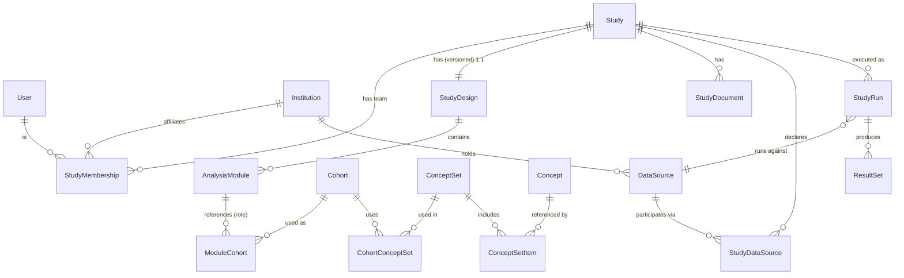

# "Study" entity — proposed data model (design only)

> Status: **proposal for discussion — nothing implemented.** No Prisma models or
> migrations have been created. This document grounds a "study" in how OHDSI and
> the EU regulatory registries actually structure observational studies, so we
> can decide how deep the marketplace should model it before writing schema.

## 1. Core insight: a "study" is a *cluster*, not one table

Across the sources, a study naturally splits into **four concerns**. Modeling them
as separate-but-linked entities (rather than one giant `Study` row) keeps each
concern independently versionable and matches how OHDSI already separates them:

| Layer | Concern | "What is it for" | Grounded in |
|---|---|---|---|
| **A. Listing** | Discovery & catalog metadata | What a researcher browses/searches in the marketplace | HMA‑EMA / EU PAS Register fields |
| **B. Team** | People & institutions | Who owns, runs, and is credited for the study | Book of OHDSI roles; EMA institution/contact fields |
| **C. Design** | The executable scientific spec | Cohorts, concept sets, analyses — the *portable, shareable* artifact | Strategus / HADES |
| **D. Execution** | Runs against data partners & results | Per‑CDM execution + aggregated evidence (the network layer) | Book of OHDSI network research; EMA data‑source fields |

The **marketplace primarily lists and trades the Design (C)**; execution (D) is
buyer/network‑side and can come later or stay external.

## 2. Entity–relationship overview

Key shape: `Study → StudyDesign → AnalysisModule → Cohort → ConceptSet → Concept`
is the portable design tree; `Study → StudyDataSource / StudyRun → ResultSet` is
the network/execution branch.

## 3. Entities & key attributes

### Layer A — Listing / discovery (`Study`)
The catalog record. Field set mirrors the EU PAS / HMA‑EMA Catalogues.

| Attribute | Type | Notes |
|---|---|---|
| id, slug | system | slug for shareable URLs |
| title, acronym | free text | |
| description, rationale, objective | free text | |
| `studyType` | **enum** | Characterization · Population‑Level Estimation · Patient‑Level Prediction (OHDSI analytics use case); optionally Methods Research vs Clinical Application |
| `designType` | **enum** | Cohort · Case‑control · Case‑only · Cross‑sectional · Self‑controlled · … (EU PAS non‑interventional designs) |
| `scope` | **enum (multi)** | Safety · Effectiveness · Drug utilisation · Disease epidemiology · Method development · … |
| conditions | **coded (MedDRA)** | therapeutic area / medical condition |
| exposures/drugs | **coded (ATC/RxNorm)** | |
| keywords/tags | free text[] | discovery facets |
| `status` | **enum** | see §5 |
| `visibility` | **enum** | draft · unlisted · public (marketplace listing control) |
| ownerId | FK → User | marketplace owner |
| version, createdAt, updatedAt | system | |

### Layer B — Team (`Person`/`StudyMembership`/`Institution`)
- **Person = our existing `User`** (already ORCID‑backed — see §7). No new identity model needed.
- **StudyMembership** (join `User`↔`Study`): `role` enum (**Lead/PI · Coordinator · Designer · Statistician · Collaborator**), `isOwner`. Grounded in Book of OHDSI roles.
- **Institution**: id, name, acronym, country (ISO 3166), `type` enum (Academic · Hospital · Regulator · Pharma · Not‑for‑profit · …), website. Studies ↔ institutions is many‑to‑many with roles (conducting / additional).

### Layer C — Scientific design (executable spec)
Grounded in Strategus. The design is a **portable, versionable, hashable** artifact.

| Entity | Purpose / key fields |
|---|---|
| **StudyDesign** (1:1 Study, versioned) | `strategusVersion`, `specJson`, `version`, `contentHash` |
| **AnalysisModule** | `moduleType` enum (CohortGenerator · CohortDiagnostics · Characterization · CohortIncidence · CohortMethod · SelfControlledCaseSeries · PatientLevelPrediction), `settingsJson` |
| **Cohort** (= phenotype) | `name`, `description`, `circeJson`, `sql`, optional `phenotypeLibraryRef`. **Constraint: cohort definitions must round‑trip with ATLAS 3.0** (its cohort‑definition JSON / WebAPI shape) — store the ATLAS/Circe expression verbatim so a cohort can be imported to / exported from ATLAS 3.0 without loss. |
| **ModuleCohort** (join Module↔Cohort) | **`role` enum: target · comparator · outcome · subject · negativeControl** — role lives on the join, *not* the cohort |
| **ConceptSet** | `name`, `expressionJson` |
| **CohortConceptSet** (join, M:N) | a cohort uses many concept sets; a concept set is reused across cohorts/studies |
| **ConceptSetItem** (join ConceptSet↔Concept) | flags on the join: `includeDescendants`, `includeMapped`, `isExcluded` |
| **Concept** (OMOP vocab reference) | `conceptId`, `conceptName`, `domainId`, `vocabularyId`, `conceptCode`, `vocabularyVersion` |
| *(advanced, optional)* | **NegativeControlOutcome**, **CovariateSettings** (FeatureExtraction), synthesized **PositiveControl** |

### Layer D — Data sources & execution (network layer)
| Entity | Purpose / key fields |
|---|---|
| **DataSource / CdmDatabase** | `name`, `dataHolder`→Institution, countries, `dataSourceType` enum (Claims · Primary care EHR · Registry · …), **`cdmName` enum (incl. OMOP)**, `cdmVersion`, `vocabularyVersion`, `populationSize`, access/consent metadata |
| **StudyDataSource** (join Study↔DataSource) | per‑site **participation `status` enum: invited · opted‑in · irb‑approved · executed · results‑shared**, `siteLead`→User, `irbRef` — federated governance (no central gate) |
| **StudyRun / Execution** | `designVersion`, `dataSourceId`, `status`, `startedAt`, `finishedAt`, `strategusVersion`, `minCellCount` |
| **ResultSet** | `runId`, `type` (diagnostics/estimate/prediction), `isAggregate`, `location` |

### Cross‑cutting — `StudyDocument`
Typed, repeatable resource attached to a Study: `type` enum (Protocol · SAP · Results · Publication · Other), `title`, `url`/upload, `doi`, `date`.

## 4. Relationships that matter (get these right up front)
- **Cohort role is a relationship attribute** — the same cohort JSON is "target" in one study and "outcome" in another. Never bake role into `Cohort`.
- **Reuse is many‑to‑many** — `Study↔Cohort` (via design), `Cohort↔ConceptSet`, `ConceptSet↔Concept`. Cohorts and concept sets are **shared library assets** (the OHDSI Phenotype Library), not owned by one study.
- **Design vs Execution are separate branches** — one portable `StudyDesign` runs against many `DataSource`s (`StudyRun`), and one CDM runs many studies. `StudyDesign ↔ DataSource` is M:N *through* runs.
- **Status lives at two levels** — the `Study` lifecycle enum, plus each `StudyDataSource`'s own participation status. A study's overall progress is partly an aggregate of site states.

## 5. Controlled vocabularies / status enums
- **`Study.status`** (OHDSI study‑repo lifecycle): `DRAFT → PROPOSED → RECRUITING → DESIGN_FINALIZED → EXECUTING → RESULTS_AVAILABLE → COMPLETE`, plus `SUSPENDED`. (OHDSI's own badge enum is Repo Created / Started / Design Finalized / Results Available / Complete / Suspended — the above is a marketplace‑friendly superset.)
- **`StudyDataSource.status`**: `invited → opted_in → irb_approved → executed → results_shared`.
- External code systems to model as lookups, not free text: **MedDRA** (conditions), **ATC/RxNorm** (drugs), **ISO 3166** (countries), **OMOP Standardized Vocabularies** (concepts). Narrative fields (objective, setting, analysis plan) stay free text.

## 6. Recommended phasing
> **Decision (2026‑08‑11): target scope is C — the full platform** (network
> execution + evidence, ARACHNE/Strategus‑as‑a‑service). The phases below are
> therefore a **recommended build order toward C**, not a scope choice — but the
> schema should be designed up front so Layers C and D attach without reshaping
> Layers A/B (treat cohorts/concept sets as a shared library namespace from day
> one, and keep the Design/Execution branches separate as in §4).

Each phase adds a bounded set of tables and leaves a clean seam for the next.

| Phase | Scope | What it enables | Cost |
|---|---|---|---|
| **A. Catalog** | Layers A + B, `Study.designRef` = external link (e.g. GitHub/Strategus repo) | Browse/search/own studies; discovery marketplace | Small — extends current `User` |
| **B. Structured design** | Add Layer C entities (Cohort/ConceptSet/Concept as first‑class) | In‑platform cohort/concept‑set reuse, diffing, machine‑readable specs | Medium |
| **C. Full platform** | Add Layer D (runs, results, data partners) | Orchestrate network execution + evidence — essentially ARACHNE/Strategus‑as‑a‑service | Large |

**Recommendation:** build **Phase A** now with the `Study` listing + `StudyMembership`
(reusing the ORCID‑backed `User`), and design the `Study → StudyDesign` seam so
Layer C can attach later without reshaping the listing. Treat cohorts/concept sets
as a shared **library** namespace from day one so reuse isn't retrofitted.

## 7. Alignment with what we already built
The auth work already gives us the **Person** entity for free: `User` has an
ORCID iD (`orcidId`), which is exactly OHDSI's investigator identity, and `name`.
`StudyMembership` is just a join from `User` to `Study` with a role. So Layer B is
mostly a thin addition on top of the existing model — no separate identity system.

## 8. Gaps to design in early (health‑data compliance)
Not in the OHDSI/registry sources but essential for a health‑data marketplace, and
cheaper to model now than to retrofit:
- **Consent records** (per user / per data use), **audit log** (who accessed/changed what), **data‑access requests & approvals**, and **retention/erasure** hooks (GDPR Art. 15/17).
- **Access control**: who can view a study's design vs. request execution vs. see results.

## 9. Sources
- Book of OHDSI — Network Research & Study Steps: https://ohdsi.github.io/TheBookOfOhdsi/NetworkResearch.html · https://ohdsi.github.io/TheBookOfOhdsi/StudySteps.html
- OHDSI Strategus study repo template (status/metadata conventions): https://github.com/ohdsi-studies/StrategusStudyRepoTemplate
- Strategus (analysis specification / execution): https://ohdsi.github.io/Strategus/ · HADES: https://ohdsi.github.io/Hades/
- Book of OHDSI — Cohorts / Population‑Level Estimation / Patient‑Level Prediction chapters
- HMA‑EMA Catalogues of RWD sources & studies — metadata list v4 (EMA/198819/2025): https://www.ema.europa.eu/system/files/documents/other/list-metadata-hma-ema-catalogues-real-world-data-sources-studies-en_0.pdf · portal: https://catalogues.ema.europa.eu/
- ClinicalTrials.gov protocol data element definitions (contrast): https://clinicaltrials.gov/policy/protocol-definitions
- HARPER / STaRT‑RWE structured protocol templates (machine‑readable design): https://onlinelibrary.wiley.com/doi/full/10.1002/pds.5507
